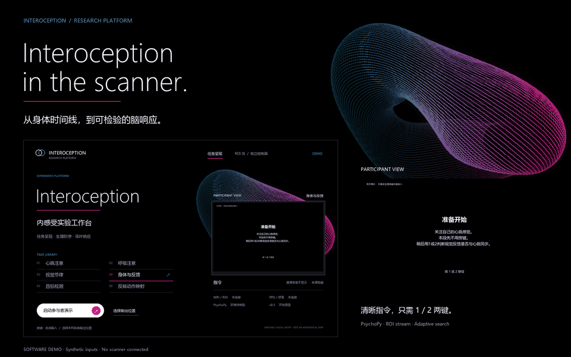

# Interoception in the scanner

**Body timing. Task space. Reproducible responses.**


[Watch the film ↗](docs/assets/program/walkthrough.mp4) · [Explore the screens](docs/program-gallery.md) · [中文研究方案](docs/interoception-protocol-2026-10.zh-CN.md) · [Run the program](experiments/interoception/README.md)

Which insular responses depend on the timing of bodily signals, and which can
also be explained by attention, external events or action requirements?

This project connects an audited MRI physiology workflow to an experimental
prototype for asking that question. The first supplies a checkable peripheral
timeline. The second combines controlled tasks, predefined insular targets,
neuroadaptive search and independent response-profile tests.

## See the program



**A 20-second software demonstration.** Inputs, triggers and responses are
synthetic. The film uses the actual presentation state machine and the same
artwork used by the native launcher and PsychoPy prompt screens. It is not a
human recording or a hardware timing test. [MP4](docs/assets/program/walkthrough.mp4)
· [Screenshots and provenance](docs/assets/program/provenance.synthetic.json).

The operator gets a task library and connection status. The participant gets
clear instructions, the prescribed stimulus and the required response. No
second pulse display supplies the answer to a heartbeat-attention task.
Current and replay feedback share the same visual treatment. The participant
uses only the available **1/2 response-box panel**; synchrony and confidence
are fixed-duration binary choices. The other hand remains with finger PPG and
the emergency squeeze bulb. [Device mapping and controls](experiments/interoception/README.md).

## From measurement to an experiment

| Stage | Question | In this repository |
|---|---|---|
| **Measure** | What was recorded, and when? | Physiological log parsing, scan-window QC, event proposals and sensitivity checks |
| **Present** | What does the participant attend to? | Six-family demonstration, source-blind four-condition probe, fixed response pages |
| **Estimate** | How do predefined regions respond? | Native-grid ROI extraction, incremental GLM, separate III and IV estimates |
| **Search** | Which condition should be sampled next? | Actual GP regression, EI or GP-UCB, versioned task space and complete decision records |
| **Verify** | Does the response profile repeat? | Independent resets, frozen optimizer and a separate test GLM |

The proposed starting target is **task-evoked beta III − beta IV**. It is a
regional contrast, not an interoceptive-accuracy score. The [2026 Nature
study](https://www.nature.com/articles/s41586-026-11175-2) supplies candidate
functional-region priors; [Lorenz et al., 2018](https://www.nature.com/articles/s41467-018-03657-3)
and [2021](https://doi.org/10.1093/brain/awab109) supply the neuroadaptive-method
baseline. [Read the method-by-method comparison](docs/romy-replication-map-2026-10.zh-CN.md).

## Run it locally

From the repository root, in a PsychoPy environment with Pillow:

```bash
python -m experiments.interoception.launcher
```

Or review the four-condition presentation with synthetic inputs:

```bash
python -m experiments.interoception.run_presentation --simulate --probe-four --quick --out /private/new_presentation_demo
```

Choose a **new output directory outside this repository**. On Windows, use
for example `D:/InteroceptionPrivate/presentation_demo_01`. For an unattended
UI smoke check, add `--autoplay`; every generated response remains synthetic.

The controller can also run without a display:

```bash
python -m experiments.interoception.simulate_neuroadaptive --out /private/new_controller_demo
```

[Full setup and controls](experiments/interoception/README.md) ·
[ROI / JSONL / PsychoPy interfaces](docs/interoception-interfaces-2026-10.md)

## What the evidence currently supports

**Recorded physiology:** 6 participants, 9 visits and 18 original logs acquired
at **3 T**. Eight long, nonconstant PPG recordings contain 621.135 recorded
minutes; nine respiratory recordings contain 711.678 recorded minutes. These
whole-log durations include non-scan and low-quality periods. They are not
quality-accepted MRI minutes or independent participant counts.

The complete previous measurement report, figures, methods and public
aggregate outputs remain in the [measurement progress report](docs/measurement-progress-2026-10.md).

**Experimental prototype:** 174 software checks pass, with native PsychoPy
smoke runs for the four-condition probe and an abstract GradCPT-style presenter.
Real-time scanner input, causal physiology adapters,
independent task geometry, ROI visibility, licensed GradCPT photographs and
physical display/response timing still require site development and pilots.
The 18 candidate presets are a software registry, not 18 validated human tasks.
The CLI presenter is deliberately restricted to simulation.

[Software verification](results/interoception_interface_validation_20261026.json)
· [Presentation verification](results/interoception_presentation_validation_20261026.json)
· [Actual PsychoPy screen](docs/assets/program/actual-psychopy-rating.synthetic.png)
· [Scientific plan](docs/interoception-protocol-2026-10.zh-CN.md)

## Design and reproducibility

The visual direction studies the spacious typography, black fields and organic
depth of [Alto Neuroscience](https://altoneuroscience.com/). All program artwork
and the parametric shell are original. The shell is a design motif, not a brain
reconstruction or measured insular manifold. No Alto logo, photograph or
illustration is redistributed. Participant measurement fields remain controlled
and achromatic. [Design decisions](docs/program-design-2026-10.md).

Rebuild the screenshots, GIF and optional H.264 film:

```bash
python scripts/export_interoception_demo.py --ffmpeg /path/to/ffmpeg
```

Human MRI, physiology, identifiers and trial-level logs stay outside the public
repository. Published Nature masks remain in the [authors' repository](https://github.com/LBCN-Stanford/Nature2026).

The historical repository name is `uhf-fmri-qc-notes`. Evaluated physiology is
3 T; ultra-high-field and layer-specific performance have not been established.
