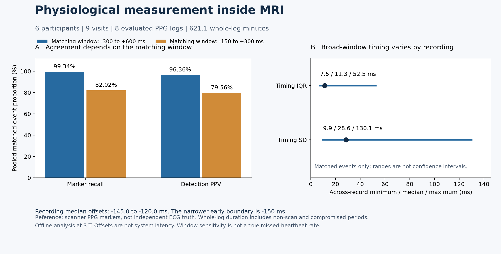

# MRI physiological measurement tools

Parse Siemens physiological logs, inspect recording quality, compare pulse
events offline, and export samples for independently audited MRI acquisition
windows. The expanded archive now runs through the public tools, with
aggregate results and synthetic manifest examples.

**25 October 2026: 6 participants, 9 visits and 18 original logs acquired at
3 T.** Eight long, nonconstant PPG recordings contain **621.135 recorded
minutes**; nine respiratory recordings contain **711.678 recorded minutes**.
These are whole-recording durations, including non-scan periods and
low-quality segments. They are **not quality-accepted MRI minutes**. Repeated
visits and pulse events do not increase the independent participant count.

The repository name `uhf-fmri-qc-notes` reflects an earlier research interest.
The evaluated data are 3 T; UHF performance and interoceptive perception
have not been validated.

## Current results

| Measurement | Current result |
|---|---|
| Recording-level PPG QC | 4 OK, 4 WARN, 1 FAIL across 9 recordings |
| Recording-level respiratory QC | 0 OK, 9 WARN, 0 FAIL across 9 recordings |
| Longest constant segment | PPG: 360.8 s; respiration: 255.6 s |
| Offline PPG comparison | 8 recordings from 6 participants; 41,523 scanner pulse markers and 42,804 detections |
| Acquisition-window export | 68 accepted channel/run exports: 32 PPG and 36 respiratory; 4 cardiac candidates refused |
| Independent export comparison | All 16,560,242 samples exactly match the 68 existing exports; relative timing and core metadata also match |

The respiratory totals include a warning for a constant interval longer than
five seconds. This changes one earlier OK verdict to WARN without changing
the samples or event-comparison results. Coarse QC does not establish event
reliability: wide-window PPV ranges from **81.17% to 99.55%** across recordings,
and an OK label is not a performance guarantee.

Both matching windows below were specified before the expanded evaluation.
They rescore the **same reference markers and detections** using greedy
one-to-one matching. Recall uses reference markers as its denominator; PPV
uses detections.

| Detection-minus-marker window | Matched pairs | Pooled marker recall | Pooled detection PPV |
|---|---:|---:|---:|
| Historical: -0.30 to +0.60 s | 41,247 | 99.3353% | 96.3625% |
| Narrower sensitivity check: -0.15 to +0.30 s | 34,056 | 82.0172% | 79.5627% |

Scanner pulse markers are not independent ECG ground truth. The narrower
window's -150 ms boundary lies near the per-record median offsets,
approximately -145 to -120 ms. Its lower matching rate cannot therefore be
read as a true missed-heartbeat rate. Offsets are marker-relative, not ECG
R-peak errors or acquisition-to-output latency. The evaluated detector uses
a whole-record percentile cap: this is an **offline comparison**, not a
streaming or closed-loop validation.

Recording-level phase/RVT helpers remain exploratory. The legacy QC CLI's
1 Hz derived-series export is not a volume/slice-sampled RETROICOR design;
respiratory phase, calibrated volume, and a complete physiological correction
pipeline have not been independently validated here.

See the [measurement summary](results/measurement_summary_20261025.json),
[validation record](results/measurement_validation_20261025.json),
[progress inventory](results/progress_summary_20261025.json), and
[measurement progress note](docs/progress-2026-10.md). The figure is generated
by [plot_measurement_summary.py](scripts/plot_measurement_summary.py).

## Integrated workflow

- **Parse:** `physio/siemens_pmu.py` separates samples, auxiliary channels,
  embedded messages and physiological markers, preserving sample indices.
  Effective rates use MDH endpoints when available; a fallback assumed rate
  is not equivalent to an audited clock.
- **Inspect:** `physio/qc.py` reports clipping, constant segments, gain messages
  and clock provenance. PPG is a pulse-oximeter waveform, not ECG;
  respiratory amplitude is in uncalibrated arbitrary units.
- **Compare:** `physio/beats.py` computes offline event agreement and
  marker-relative timing. Empty denominators remain undefined.
- **Export:** `physio/bids.py` and `scripts/export_bids_physio.py` write
  headerless `recording-cardiac` / `recording-respiratory` TSV.GZ and JSON
  with `SamplingFrequency`, `StartTime` and `Columns`. Each channel retains
  its rate and offset, with up to five seconds of existing context on either
  side. No interpolated samples or synthetic padding are added.
- **Summarize:** `scripts/evaluate_cohort.py` processes an explicit private
  visit manifest into aggregate measurements. Optional detailed output stays
  private. Duplicate sources are rejected.

Export rejects missing clock endpoints, inadequate coverage and a constant
signal within the strict acquisition interval. Samples outside that interval
cannot rescue a flat run. Existing outputs are not overwritten, and output
directories must be separate from raw inputs. File acceptance does not
establish reliable physiological measurement throughout the window.

## Usage

Run from the repository root:

~~~bash
python -m pip install -r requirements.txt
python -m pytest tests -q

python scripts/evaluate_cohort.py --manifest COHORT.private.json --out OUTPUT/measurement_summary.json --details OUTPUT/measurement_details.private.json
python scripts/export_bids_physio.py --manifest RUNS.private.json --out OUTPUT/bids_physio --report OUTPUT/export_report.private.json
~~~

Replace placeholders with private locations outside the repository. Actual
manifests, raw logs, detailed reports and identity mappings are not published.
Review aggregate output before sharing. Raw-data-dependent tests skip when
their inputs are unavailable; synthetic tests do not reproduce the
participant results.

The initial test run passed 45 tests and skipped six real-data cases because
the configured legacy paths did not resolve. A subsequent private path mapping
located eight required current-source files and reran those six unchanged
assertions: **6 passed** (four visit-level QC cases and two pulse-detector
cases). All 12 rediscovered source copies match the archived hashes. This
confirms the assertions on the current archive; old result files lack input
hashes, so historical input-byte identity remains unresolved. A passing QC
test can mean correctly identifying a failed signal.

The [cohort example](examples/cohort.example.json) contains one row per visit
with `recording_id`, `participant_id`, `visit_id`, `puls` and `resp`.
Two rows demonstrate repeated visits from one fictitious participant.
Relative raw paths resolve beside the manifest.

The [run example](examples/runs.example.json) supplies a BIDS filename prefix
as `run_id`, an externally audited `volume_start`, `duration_seconds`,
and available `puls` / `resp` paths. Numeric onsets mean seconds since
midnight; strings use explicit `HH:MM:SS.fraction` notation. Example clocks
are fictional. The exporter does not reconstruct onset from DICOM or infer
MRI triggers. A local acquisition audit identified a **1.485 s**
first-slice-versus-volume-onset discrepancy, illustrating why the supplied
onset must be checked independently.

MDH endpoint alignment assumes uniform sampling. It does not independently
verify hardware rate, dropped samples, jitter or nonlinear drift.
Physiological markers are not MRI TTL pulses. Trial-level stimulus/response
alignment awaits task event logs and verified clock/trigger mapping;
E-Prime timestamps alone do not prove a shared time base.

## Historical evidence and next steps

The initial benchmark covered **2 participants, 3 PPG recordings and about
209 minutes**. Its [stored summary](results/beat_eval_summary.json) is retained
unchanged. The expanded evaluation uses corrected parsing and sample
indexing and is a new result rather than a replacement of that artifact.

Historical respiratory reports lack input hashes and describe shorter files
with missing footers. Current complete files contain those endpoints.
Input equivalence and the cause of the discrepancy remain unresolved; it
cannot be attributed to a confirmed acquisition failure.

Next work is to establish **segment-level valid measurement time**, add
independent event annotation/reference measurements, and test prospective
streaming with measured acquisition-to-output timing. Whole-record duration,
QC labels and scanner-marker agreement alone do not establish those outcomes.

The event scorer retains legacy latency/jitter field aliases, but they mean
marker-relative offset and dispersion. Current QC output uses
`pulse_rate_bpm_*`, `pulse_interval_outliers_pct`,
`scanner_physiological_markers`, and `resp_start_minus_puls_start_s`;
consumers of older QC field names need updating.

Research/development software. See [LICENSE](LICENSE) for the MIT licence.
