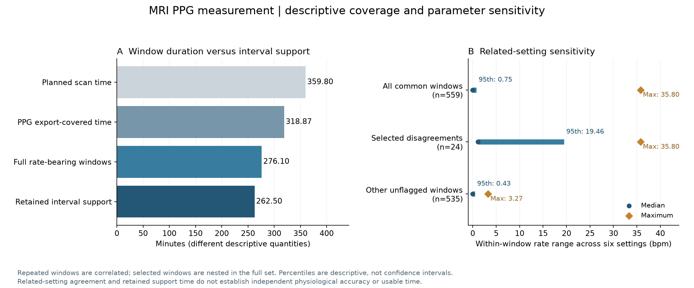

# PPG parameter sensitivity and retained interval support

This analysis follows the automated-proposal stage without adding manual
labels or retuning the six previously fixed settings. It distinguishes coarse
median-interval pulse-rate sensitivity from candidate-event agreement, and
measures the actual time support of retained candidate intervals.

## Comparison design

Each of the six filter/prominence settings is evaluated separately on all
32 cardiac exports. The comparison keeps original waveform QC and known
artifact supports with the existing 0.20 s margin. It deliberately does not
apply the six-setting consensus ambiguity mask to every setting: doing that
would condition agreement on consensus selection.

Candidate intervals are between adjacent original candidates inside the
same half-open window. Both endpoints must avoid ADC boundaries; the interval
must not cross a known artifact support. Discarded candidates are never
bridged. Pulse rate is 60 divided by the median retained interval, requiring
at least five intervals and the original `no_rule_flag` state. Missing or
insufficient estimates remain undefined.

For common windows, the rate range is the maximum minus minimum of the six
estimates. Candidate-count spread is `100 * (maximum - minimum) / median`
of the six raw candidate counts. Rate-range cutoffs of 2/5/10 bpm and a 10%
count-spread cutoff describe sensitivity; they are not validated acceptance
criteria or physiological error tolerances. The methods use correlated
transformations of one waveform, so agreement cannot rule out shared errors.

## Results



| Descriptive quantity | Result |
|---|---:|
| Export-covered / original unflagged windows | 646 / 560 |
| Unflagged windows with all six rate estimates | 559 |
| Rate range at most 2 / 5 / 10 bpm | 544 / 551 / 553 windows |
| Median / 95th percentile / maximum rate range | 0.00 / 0.75 / 35.80 bpm |
| Windows with rate range above 5 bpm | 8, all in one scan and one visit |
| Rate range at most 5 bpm but count spread above 10% | 4 windows |

All eight windows with a range above 5 bpm belong to the previously selected
24 disagreement windows. The selected subset's median range is 1.08 bpm and
its 95th percentile is 19.46 bpm. In the remaining 535 common windows, the
maximum is 3.27 bpm. This is a descriptive concentration of observed
sensitivity, not a prospective diagnostic test or participant-level result.
The selected subset was chosen from the same dataset based on prior detector
disagreement, and its windows are not independent observations.

Similar median-interval rates can coexist with different candidate counts.
The four windows in that category include two selected windows and two
others. None has thereby established precise beat recognition or timing.
No setting is chosen as the winner and no pseudo-labels are used as truth.

## Interval support versus complete window time

| Time quantity | Minutes |
|---|---:|
| All planned scan windows | 359.80 |
| Scan time with cardiac exports | 318.87 |
| Full duration of the 559 prior rate-bearing windows | 276.10 |
| Disjoint retained adjacent-interval support within those windows | 262.50 |

The last row sums 18,692 eligible adjacent intervals from the prior
consensus-proposal output. It excludes rejected-candidate gaps, uncertainty
crossings and unbracketed window edges. Within each window, these intervals
do not overlap in duration. It is deliberately stricter than reporting the
entire duration of a window that has any estimate.

The median within-window support fraction is 96.69%, with a minimum of 31.87%.
Partial support and selection can influence a rate estimate. Neither 276.10
nor 262.50 minutes represents independently validated usable physiology.
The four absent cardiac runs remain absent; this analysis does not recover
their source signal.

## Interpretation for MRI interoception measurement

The current evidence supports a reproducible **offline physiological
measurement workflow**: source verification, audited scan extraction,
window screening, traceable candidate events, explicit uncertainty and
descriptive rate sensitivity. Coarse rate estimates vary little across
these particular settings in most common windows, while event-level
ambiguity remains concentrated and observable.

This is a measurement foundation for an interoception experiment, not a
validated measure of subjective interoceptive accuracy. Independent event
references and verified clocks are still needed before exact cardiac-phase,
trial-timing or streaming claims. No new behavioral or brain analysis is
performed. The observed waveform issues cannot be causally attributed to
MRI gradients from this analysis alone.

## Reproduction

```bash
python scripts/analyze_ppg_sensitivity.py \
  --windows /private/window_qc/window_qc_details.private.json \
  --proposals /private/provisional_ppg/pseudo_labels.private.json \
  --out /private/ppg_sensitivity

python scripts/plot_ppg_sensitivity.py \
  --summary /private/ppg_sensitivity/sensitivity_summary.json \
  --out /private/ppg_sensitivity/summary.png

python -m pytest tests/test_ppg_sensitivity.py -q
```

The analysis reproduces all 32 central candidate arrays, all 192
setting/run event counts and all 646 prior window rate/interval results.
The private output preserves each setting's original sample indices.
Aggregate summaries and figures are public; detailed event arrays, scan
identifiers and the Chinese report remain local.

See [aggregate results](../results/ppg_sensitivity_summary_20261025.json)
and [checks](../results/ppg_sensitivity_validation_20261025.json). Repeated
windows and visits do not increase the independent participant count of six.
