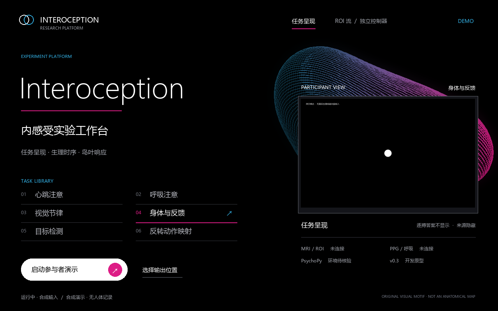
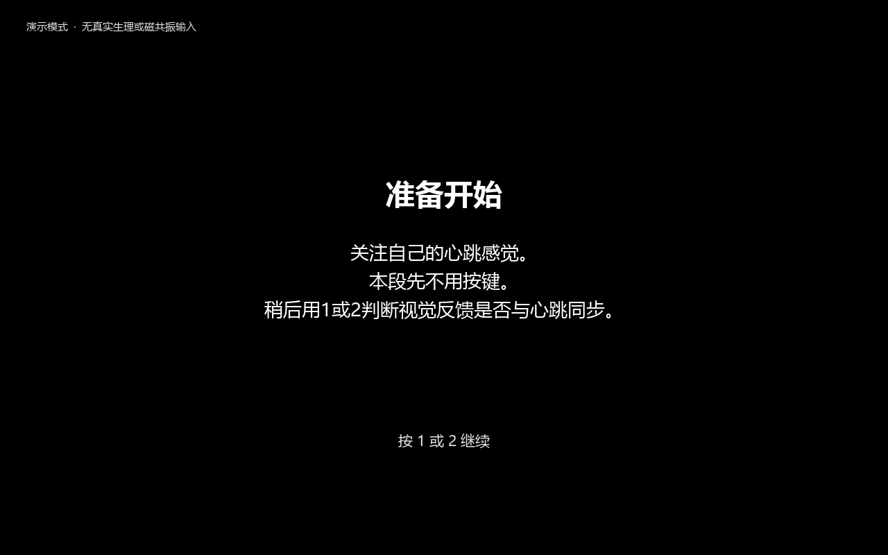
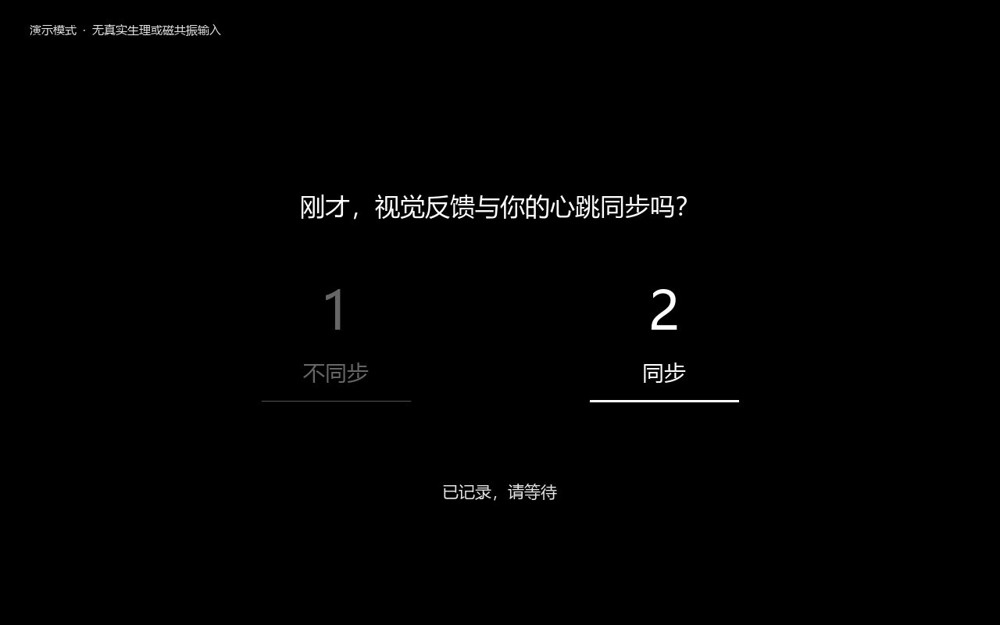
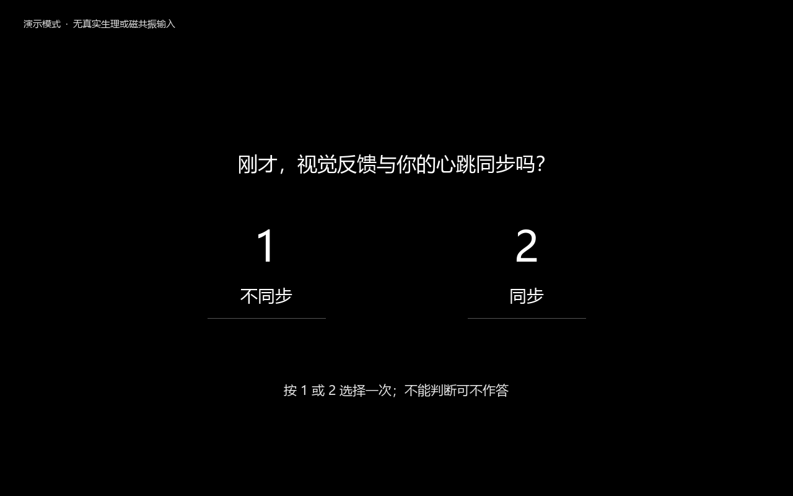

# Interoception · program screens

Black fields, light typography and a single original three-dimensional motif.
These are the shared program renderer's screens, driven by the actual
presentation state machine with synthetic inputs.

[Watch the 20-second film](assets/program/walkthrough.mp4) ·
[Animated walkthrough](assets/program/walkthrough.gif) ·
[Run the program](../experiments/interoception/README.md)

## Operator workspace

## Participant instructions

## A single prescribed feedback cue

## Two buttons, one response

The participant uses the available 1/2 panel. No extra confirmation key is
needed; unanswered pages remain missing. Device, model and source labels stay
on the operator side.

## Native PsychoPy window check

This capture is from a real PsychoPy window with synthetic autoplay. Capturing
interrupts frame performance; it does not validate physical display or response
latency. [Verification](../results/interoception_presentation_validation_20261026.json)
· [Media provenance](assets/program/provenance.synthetic.json).

For the local full-screen exhibition, open
`docs/assets/program/index.preview.html` from your checkout in a browser.
