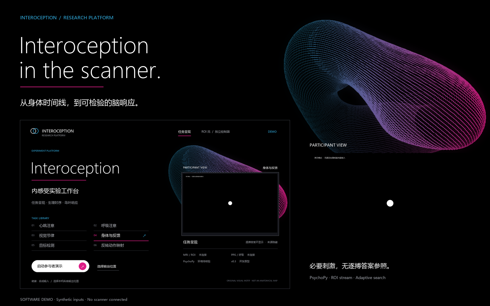
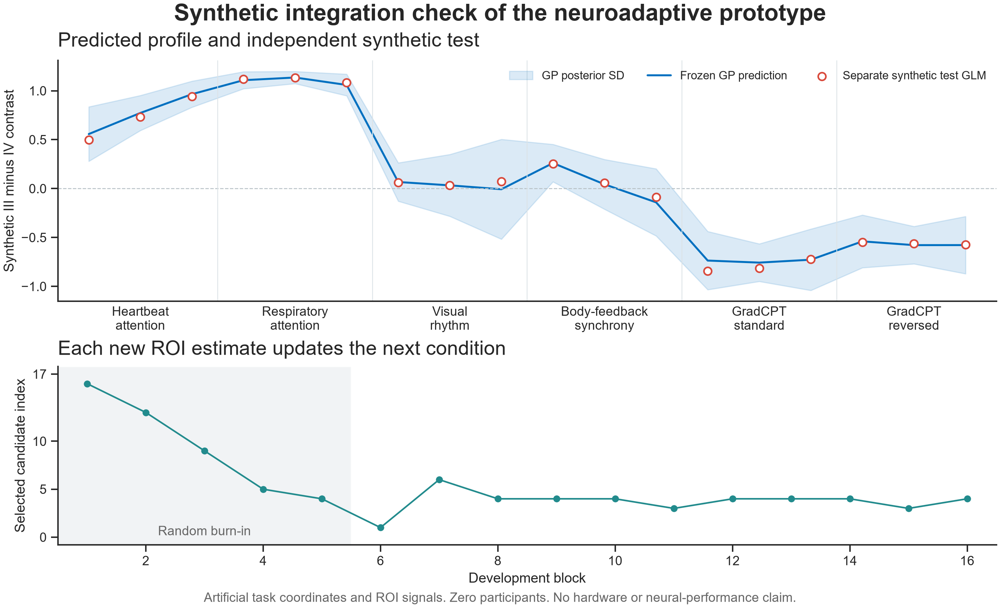

# Neuroadaptive interoception prototype

Version 0.3 adds a native desktop launcher and a PsychoPy task-library
demonstration. The v0.2 controller connects a proposed task registry to ROI-stream GLM estimates,
**real GP regression and EI/GP-UCB selection**. PsychoPy is the presentation
platform. Chang Geng equipment and scientific calibration are pending.



[20-second film](../../docs/assets/program/walkthrough.mp4) ·
[Animated walkthrough](../../docs/assets/program/walkthrough.gif) ·
[Program screens](../../docs/program-gallery.md)

## Launch the program

In a PsychoPy environment with Pillow, from the repository root:

```bash
python -m experiments.interoception.launcher
```

The desktop launcher is an actual Tk canvas drawn by `ui.operator_card`, not a
browser mockup. Select a task by mouse or keys 1–6; `O` selects a private output
parent, and Enter starts a synthetic participant demonstration. The launcher
does not start MRI acquisition or connect physiology. Use the same Python
environment for the launcher and PsychoPy. On this Windows workstation:

```powershell
& 'C:/Program Files/PsychoPy/python.exe' -m experiments.interoception.launcher
```

Directly run one family or the four-condition probe:

```bash
python -m experiments.interoception.run_presentation --simulate --family heartbeat_attention --out /private/new_heartbeat_demo
python -m experiments.interoception.run_presentation --simulate --probe-four --quick --out /private/new_probe_demo
```

Participant controls use only the available **1/2 panel**. Either key continues
instructions. During Go/No-go or visual-rhythm tasks, 1 is the response key.
Synchrony uses 1 = not synchronous, 2 = synchronous; confidence uses
1 = lower confidence, 2 = higher confidence. The first valid press locks the
answer and pages keep fixed durations. No press remains missing, with no
inference that it means inability to sense. This binary endpoint replaces the
earlier graded-scale draft and needs a new behavioural pilot.

`5` is an **operator/demo software trigger**, separate from participant responses;
Escape is an operator abort. Neither is required from the participant.
The nonresponse hand keeps the finger PPG and emergency squeeze bulb; the
respiratory belt/pad remains connected to Siemens recording. Recording/export
availability alone does not establish a causal online physiology stream.

First check the real response-box key names locally, then fill a private copy
of `button_mapping.template.json` and pass `--button-map /private/mapping.json`:

```bash
python -m experiments.interoception.response_box_check --seconds 20 --out /private/new_keycode_check
```

The default 1/2 and numpad aliases are unverified placeholders, not a hardware
claim. `--autoplay` inserts clearly labelled
synthetic actions; `--capture` stores actual PsychoPy back-buffer screenshots
and intentionally interrupts frame performance. `--screen` and `--fullscreen`
select a display for later local review, not site-calibrated viewing geometry.

| Family | Demonstration stimulus | Human-use work still required |
|---|---|---|
| Heartbeat / respiration attention | Neutral central fixation | Attention pilot and simultaneous physiology |
| Visual rhythm | Achromatic intensity targets and response events | Timing, luminance, target sequence and scoring calibration |
| Body–feedback synchrony | Source-blind cue and two fixed binary response pages | Causal PPG/replay adapters, attention pilot and feedback matching |
| GradCPT standard / reversed | Abstract city/mountain transitions | Licensed photos, original timing, response windows and scoring |

All CLI presentations require `--simulate`. The state model has explicit
real-mode gates for calibration and adapters; the native presenter currently
supports demonstration materials. Neither a filled profile nor a boolean
proves that a human protocol has been validated.

Read the [Chinese plan](../../docs/interoception-protocol-2026-10.zh-CN.md),
[method comparison](../../docs/romy-replication-map-2026-10.zh-CN.md) and
[event contract](../../docs/interoception-interfaces-2026-10.md).

## Full synthetic controller

From the repository root with NumPy and SciPy:

```bash
python -m experiments.interoception.simulate_neuroadaptive --out /private/neuroadaptive_mock_01
```

Use a new local output outside the repository, for example
`D:/InteroceptionPrivate/neuroadaptive_mock_01`. The default has two independent
searches, each with 16 development blocks and an 18-condition independent
test profile. All ROI signals/coordinates are synthetic. There are zero
participants, real masks or devices. Verification is not a neuroscience result
or power analysis. `--acquisition gp_ucb` switches acquisition;
`--direction -1` requests the opposite contrast in a separate search.

## Stream bridge

```bash
python -m experiments.interoception.stream_controller --space experiments/interoception/taskspace.synthetic.json --input-jsonl - --out /private/controller_01 --run-id synthetic_run_1
```

Send one JSON event per line. The first can be
`{"kind":"request_next","now_s":0}`. Only matching actual start/end messages
and eligible ROI volumes allow another update. A path instead of `-` replays
a recorded JSONL stream. No device port or stimulus is actuated.

The site template deliberately keeps coordinates and calibration IDs empty.
Its six families and three presets per family are proposed, not 18 completed
human tasks. Independent geometry, normalization, ROI and calibration IDs
must be supplied before a site-stream dry run.

## Native-space ROI adapter

`roi_input.extract_roi_input` accepts a 3D volume, III/IV masks on the same EPI
grid, an independent baseline and a space ID. It returns paired PSC values
and provenance. It does not register the original MNI masks, preprocess
images, infer units or prove baseline independence. Source masks are linked,
not redistributed.

## PsychoPy flip hooks

```python
import queue
from experiments.interoception.psychopy_bridge import NamedTaskClock, PsychoPyBlockBridge

events = queue.SimpleQueue()
clock = NamedTaskClock(space["clock_id"], native_psychopy_task_clock)
bridge = PsychoPyBlockBridge(space, session.run_id, session.definition_hash)

# Draw the selected task. Record its actual start on flip.
bridge.queue_start_on_flip(win, command, clock, planned_duration_s, events.put)
win.flip()
session.dispatch(events.get_nowait())

# Draw fixation at its end. Replace planned duration with actual offset.
bridge.queue_end_on_flip(win, command["block_id"], clock, events.put)
win.flip()
session.dispatch(events.get_nowait())
```

This excerpt is an integration hook, not a complete task presenter. Process
ROI events and computation serially outside flip callbacks. The callback
timestamp is software timing, not a photodiode measurement or MRI TTL. Enter
test after controller freeze with
`bridge.set_phase("test", not_before_s=freeze_time, freeze_receipt=receipt)`.

Human task calibration, attention checks, licensed GradCPT materials and
physiological feedback adapters still need implementation and pilots. The
old entrypoint now redirects to the source-blind four-condition review:

```bash
python -m experiments.interoception.psychopy_task --simulate --quick --out /private/four_condition_display_01
```

It requires an installed [PsychoPy environment](https://www.psychopy.org/download.html),
permanently labels simulation mode, and uses left/right, space and escape.
Unconfirmed responses stay missing. It is a local probe demo, not the new
multi-task optimizer or a validated heartbeat task.

## Validation



The curve is an arbitrary simulator function. It cannot support a conclusion
that any named task has higher or lower activity in real insular regions.

Checks cover GP calculations, snapshot replacement, clocks/availability,
actual-offset GLMs, masks and PSC, freeze boundaries, separate test GLMs, and
PsychoPy callback contracts. Fake windows do not validate physical timing.
The v0.3 native smoke runs use installed PsychoPy with synthetic autoplay;
no live MRI, physiology, physical display or response-box timing was tested. See the
[verification record](../../results/interoception_interface_validation_20261026.json).

Native program checks are in the separate
[presentation record](../../results/interoception_presentation_validation_20261026.json).

```bash
python -m pytest tests/test_interoception_contracts.py tests/test_neuroadaptive.py tests/test_roi_glm.py tests/test_roi_input.py tests/test_psychopy_bridge.py tests/test_neuroadaptive_session.py -q
python -m pytest tests/test_presentation.py tests/test_interoception_ui.py -q
```

The old simulate module still uses a balanced fallback and is not called
Bayesian optimization. Official API references: PsychoPy
[Window](https://psychopy.org/api/visual/window.html) and
[Keyboard](https://psychopy.org/api/hardware/keyboard.html).

The default conservative simulation schedule would exceed a short clinical
scan if applied literally. It is not the proposed final human scan budget;
timing, coverage, repeated visits and faster estimable updates require pilot
evaluation. Figure reproduction additionally requires matplotlib and seaborn.
